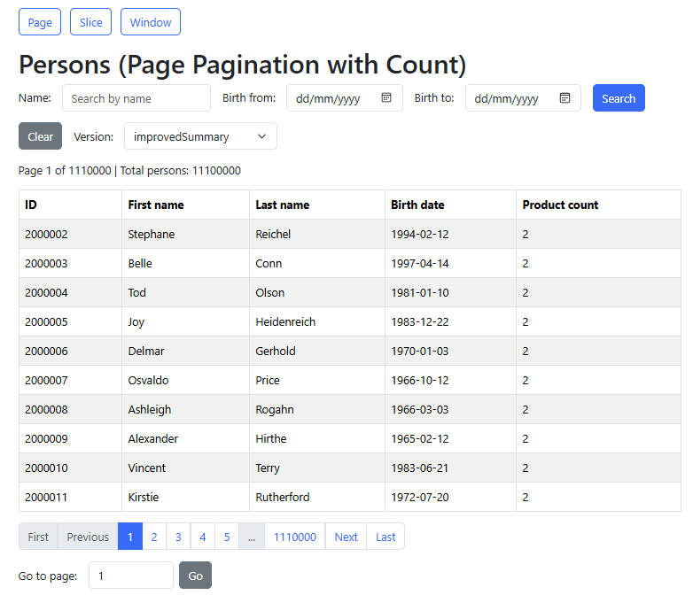
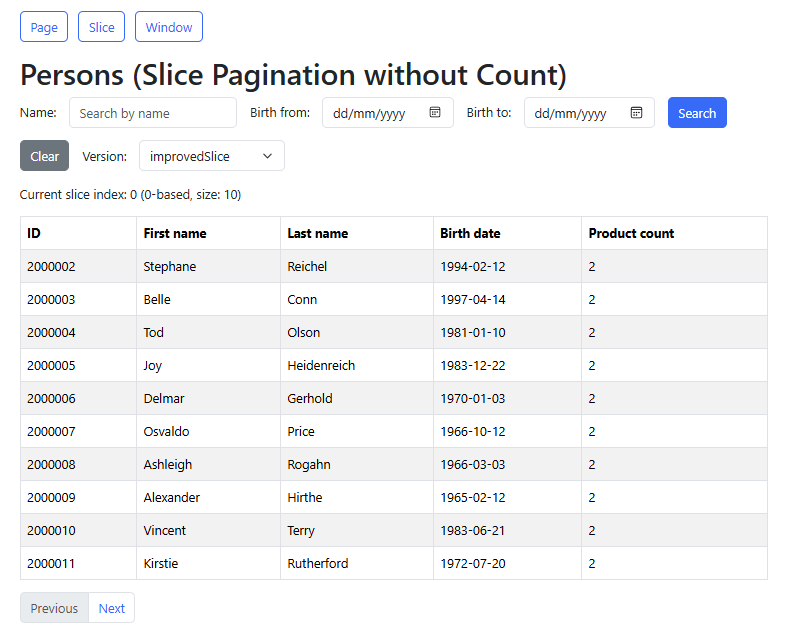

# Different Pagination Strategies

- I created this demo project to run **Different Pagination Strategies** **(Page, Slice, Window)** against a PostgresSQL dataset seeded with ~11M persons and ~22M products,
with each person having two products.

# Docs

- Here [article](docs/article.md) I described the problem, my observations and my own explanations.
- Here [WHAT_I_LEARNED](docs/WHAT_I_LEARNED.md) I mentioned other things I discovered while studying **Different Pagination Strategies**.
- Medium article -> [link](https://medium.com/@saadmeddiche2004201/why-is-page-1-fast-but-page-20k-slow-c1020b1cbc44)

# How to run and play with project

- Tweak the seeder properties in [application.yaml](src/main/resources/application.yaml) , and spin the database from [docker-compose.yaml](docker-compose.yml)

# Views

- All the views have **bad** and good version; they share the same filters but their navigation context differs.

Here's a concise TL;DR section to summarize the findings:

---

## TL;DR

- **The Problem:** Deep pages in `OFFSET`-based pagination are slow because the database must scan, sort, join, and discard millions of rows before returning the requested page. Additionally, Spring's default `Page<T>` executes an expensive `COUNT` query with unnecessary `JOIN`s.

- **Optimization 1 (Custom Count Query):** Removing unnecessary `JOIN`s and `GROUP BY` clauses from the `COUNT` query improves count latency by over 90% (from ~22s to <1.7s).

- **Optimization 2 (Split OFFSET from JOINs):** Fetching indexed IDs first via `OFFSET`, then loading details using `WHERE id IN (...)`, eliminates heavy join operations on discarded rows—reducing deep-page latency from **~3.5 minutes to ~1.7 seconds**.

- **Alternative Approaches:**
  - **`Slice<T>`:** Drops the expensive `COUNT` query, suitable when total page counts are not required.
  - **`Window<T>` (Keyset / Cursor Pagination):** Replaces `OFFSET` with a cursor (`WHERE id > :lastSeenId`). It jumps directly to the target record, maintaining consistent **~2ms query times** regardless of depth.

---