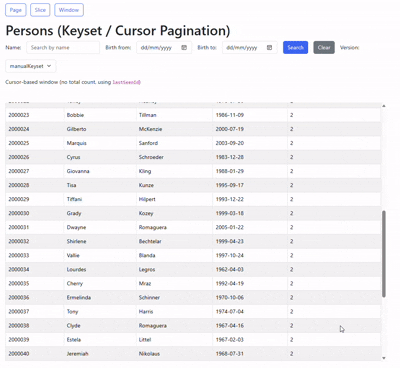

# Different Pagination Strategies

- I created this demo project to run **Different Pagination Strategies** against a PostgresSQL dataset seeded with ~11M persons and ~22M products,
with each person having two products.

# Docs

- This [article](docs/article.md) describes the problem, my observations and my own explanations.
- Here [WHAT_I_LEARNED](docs/WHAT_I_LEARNED.md) I mentioned other things I discovered while studying **Different Pagination Strategies**.

# How to run and play with project

- Tweak the seeder properties in [application.yaml](src/main/resources/application.yaml) , and spin the database from [docker-compose.yaml](docker-compose.yml)

# Views

- All the views have **bad** and good version; they share the same filters but their navigation context differs.

