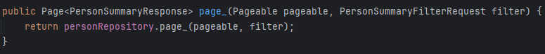
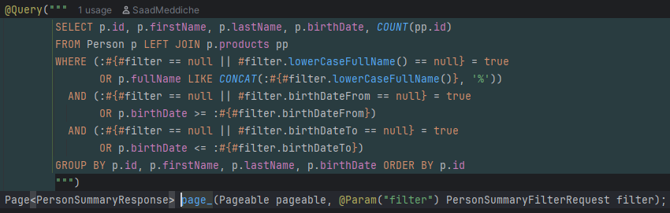
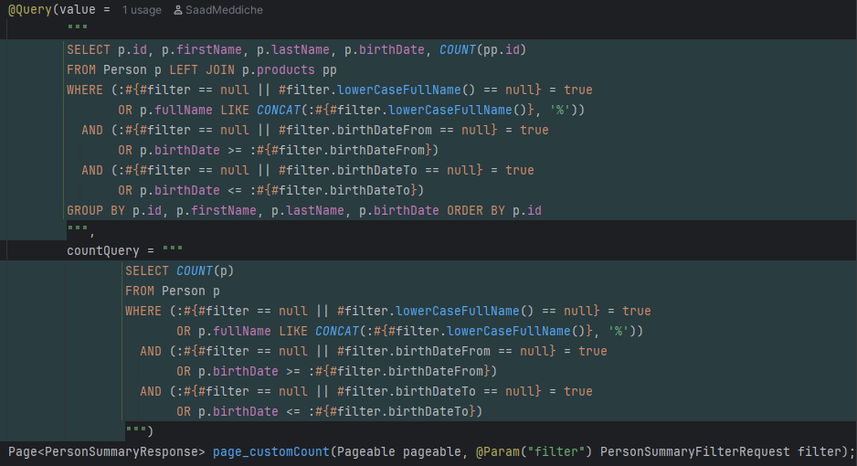
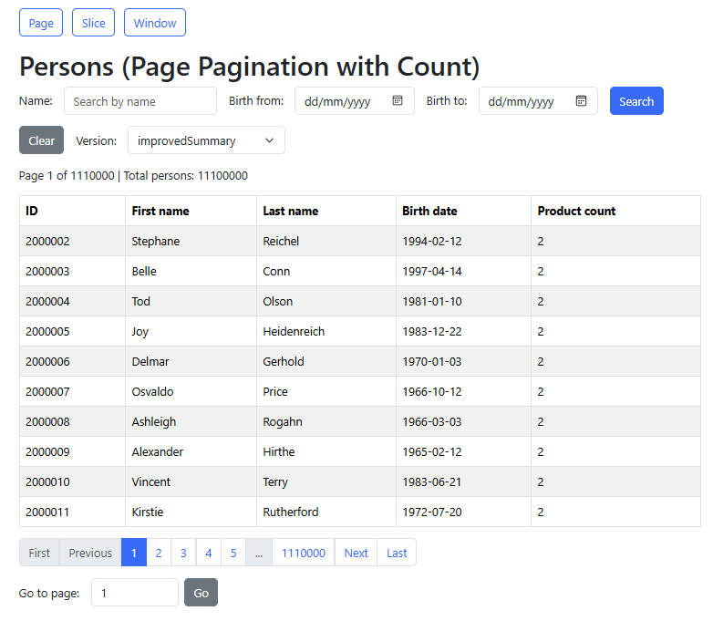
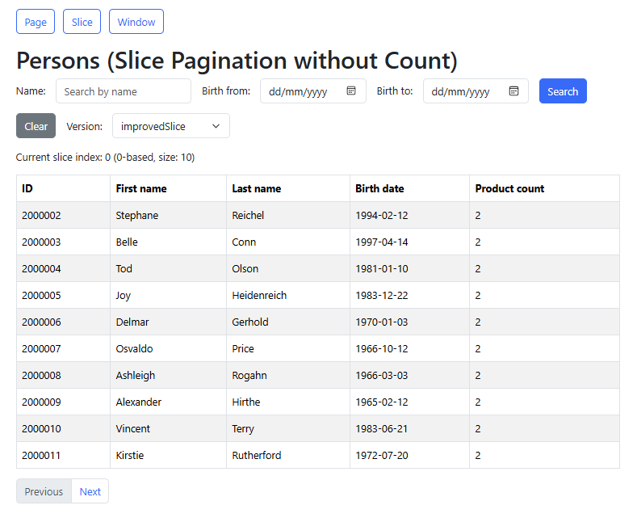
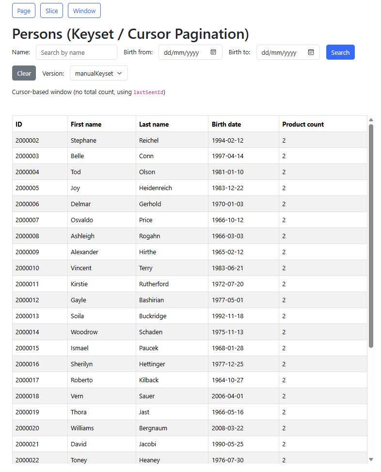

# Why is Page 1 fast, but Page 20k slow
- I was maintaining a project, and I noticed some latency in a paginated API, particularly on deep pages.
- That's when I wondered why the first **(shallow)** pages were fast, but the last **(deep)** ones were slower ?

# Investigation phase
- I checked the code source and found the usual problems (N+1 queries, lack of projection, no indexes ...).
- After fixing these "usual" issues, I noticed a significant improvement in latency, **but the deep pages remained slower than first ones.**
- That means there's something I'm missing !!

# Production was fine, but my curiosity wasn't
- This latency didn't cause any issues in production, since the user applies a filter that generates either a single page or several dozens pages.
- BUTTT The curious me wanted to understand the "why" !!

# The Demo
- I created a demo to run tests against a PostgresSQL dataset seeded with ~11M persons and ~22M products, with each person having two products.
- Feel free to run the demo locally and conduct your own tests. [GitHub Repo](https://github.com/saad-meddiche-medium-articles/Spring-Data-JPA-Pagination)

## Page\<T\>

1. **What Spring give us out of the box** 

- Service



- Repository



- Produced two queries, one to retrieve the requested page 
and second is a count query to get the total items to calculate total pages.
But the latency varies based on the page number


- Requesting `page 0` with a `size of 10` items:
  - Retrieval query took `0 Minutes : 0.015 Seconds`
  - Count query took `0 Minutes : 21.787 Seconds`

```
2026-07-23T10:39:01.502+01:00 DEBUG 5868 --- [spring-data-jpa-pagination] [omcat-handler-0] n.t.d.l.l.SLF4JQueryLoggingListener      :
Name:dataSource, Connection:4, Time:15, Success:True
Type:Prepared, Batch:False, QuerySize:1, BatchSize:0
Query:["select p1_0.id,p1_0.first_name,p1_0.last_name,p1_0.birth_date,count(p2_0.id) from person p1_0 left join product p2_0 on p1_0.id=p2_0.owner_id where (?=true or p1_0.full_name like (?||'%') escape '') and (?=true or p1_0.birth_date>=?) and (?=true or p1_0.birth_date<=?) group by p1_0.id,p1_0.first_name,p1_0.last_name,p1_0.birth_date order by p1_0.id fetch first ? rows only"]
Params:[(true,NULL(VARCHAR),true,NULL(DATE),true,NULL(DATE),10)]

2026-07-23T10:39:23.306+01:00 DEBUG 5868 --- [spring-data-jpa-pagination] [omcat-handler-0] n.t.d.l.l.SLF4JQueryLoggingListener      :
Name:dataSource, Connection:4, Time:21787, Success:True
Type:Prepared, Batch:False, QuerySize:1, BatchSize:0
Query:["select count(p1_0.id) from person p1_0 left join product p2_0 on p1_0.id=p2_0.owner_id where (?=true or p1_0.full_name like (?||'%') escape '') and (?=true or p1_0.birth_date>=?) and (?=true or p1_0.birth_date<=?) group by p1_0.id,p1_0.first_name,p1_0.last_name,p1_0.birth_date"]
Params:[(true,NULL(VARCHAR),true,NULL(DATE),true,NULL(DATE))]
```

- Requesting `page 1_110_000` with a `size of 10` items:
    - Retrieval query took `3 Minutes : 39.219 Seconds`
    - Count query took `0 Minutes : 24.865 Seconds`
    - Also, higher disk read activity ~~(I won't go into detail about database usage statistic, as I'm focusing on the latency here. Feel free to run the demo locally and conduct your own tests)~~

```
2026-07-23T11:44:05.300+01:00 DEBUG 5868 --- [spring-data-jpa-pagination] [omcat-handler-9] n.t.d.l.l.SLF4JQueryLoggingListener      :
Name:dataSource, Connection:7, Time:219219, Success:True
Type:Prepared, Batch:False, QuerySize:1, BatchSize:0
Query:["select p1_0.id,p1_0.first_name,p1_0.last_name,p1_0.birth_date,count(p2_0.id) from person p1_0 left join product p2_0 on p1_0.id=p2_0.owner_id where (?=true or p1_0.full_name like (?||'%') escape '') and (?=true or p1_0.birth_date>=?) and (?=true or p1_0.birth_date<=?) group by p1_0.id,p1_0.first_name,p1_0.last_name,p1_0.birth_date order by p1_0.id offset ? rows fetch first ? rows only"]
Params:[(true,NULL(VARCHAR),true,NULL(DATE),true,NULL(DATE),11099990,10)]

2026-07-23T11:44:30.176+01:00 DEBUG 5868 --- [spring-data-jpa-pagination] [omcat-handler-9] n.t.d.l.l.SLF4JQueryLoggingListener      :
Name:dataSource, Connection:7, Time:24865, Success:True
Type:Prepared, Batch:False, QuerySize:1, BatchSize:0
Query:["select count(p1_0.id) from person p1_0 left join product p2_0 on p1_0.id=p2_0.owner_id where (?=true or p1_0.full_name like (?||'%') escape '') and (?=true or p1_0.birth_date>=?) and (?=true or p1_0.birth_date<=?) group by p1_0.id,p1_0.first_name,p1_0.last_name,p1_0.birth_date"]
Params:[(true,NULL(VARCHAR),true,NULL(DATE),true,NULL(DATE))]
```

- I noticed that the default count query included an `unnecessary LEFT JOIN`, we might get better results by removing that `JOIN`.

2. **Removing the unnecessary COUNT JOIN**

- In this test I have `overridden the count query` to remove the LEFT JOIN.



- Requesting `page 0` with a `size of 10` items:
  - Retrieval query took `0 Minutes : 0.002 Seconds`
  - Count query took `0 Minutes : 0.207 Seconds`

```
2026-07-23T13:23:22.513+01:00 DEBUG 28032 --- [spring-data-jpa-pagination] [mcat-handler-15] n.t.d.l.l.SLF4JQueryLoggingListener      : 
Name:dataSource, Connection:11, Time:3, Success:True
Type:Prepared, Batch:False, QuerySize:1, BatchSize:0
Query:["select p1_0.id,p1_0.first_name,p1_0.last_name,p1_0.birth_date,count(p2_0.id) from person p1_0 left join product p2_0 on p1_0.id=p2_0.owner_id where (?=true or p1_0.full_name like (?||'%') escape '') and (?=true or p1_0.birth_date>=?) and (?=true or p1_0.birth_date<=?) group by p1_0.id,p1_0.first_name,p1_0.last_name,p1_0.birth_date order by p1_0.id offset ? rows fetch first ? rows only"]
Params:[(true,NULL(VARCHAR),true,NULL(DATE),true,NULL(DATE),40,10)]

2026-07-23T13:23:22.724+01:00 DEBUG 28032 --- [spring-data-jpa-pagination] [mcat-handler-15] n.t.d.l.l.SLF4JQueryLoggingListener      : 
Name:dataSource, Connection:11, Time:207, Success:True
Type:Prepared, Batch:False, QuerySize:1, BatchSize:0
Query:["select count(p1_0.id) from person p1_0 where (?=true or p1_0.full_name like (?||'%') escape '') and (?=true or p1_0.birth_date>=?) and (?=true or p1_0.birth_date<=?)"]
Params:[(true,NULL(VARCHAR),true,NULL(DATE),true,NULL(DATE))]
```

- Requesting `page 1_110_000` with a `size of 10` items:
  - Retrieval query took `3 Minutes : 30.366 Seconds`
  - Count query took `0 Minutes : 1.76 Seconds`
  - Also, higher disk read activity

```
Name:dataSource, Connection:12, Time:210366, Success:True
Type:Prepared, Batch:False, QuerySize:1, BatchSize:0
Query:["select p1_0.id,p1_0.first_name,p1_0.last_name,p1_0.birth_date,count(p2_0.id) from person p1_0 left join product p2_0 on p1_0.id=p2_0.owner_id where (?=true or p1_0.full_name like (?||'%') escape '') and (?=true or p1_0.birth_date>=?) and (?=true or p1_0.birth_date<=?) group by p1_0.id,p1_0.first_name,p1_0.last_name,p1_0.birth_date order by p1_0.id offset ? rows fetch first ? rows only"]
Params:[(true,NULL(VARCHAR),true,NULL(DATE),true,NULL(DATE),11099990,10)]

2026-07-23T13:29:37.962+01:00 DEBUG 28032 --- [spring-data-jpa-pagination] [mcat-handler-18] n.t.d.l.l.SLF4JQueryLoggingListener      : 
Name:dataSource, Connection:12, Time:1760, Success:True
Type:Prepared, Batch:False, QuerySize:1, BatchSize:0
Query:["select count(p1_0.id) from person p1_0 where (?=true or p1_0.full_name like (?||'%') escape '') and (?=true or p1_0.birth_date>=?) and (?=true or p1_0.birth_date<=?)"]
Params:[(true,NULL(VARCHAR),true,NULL(DATE),true,NULL(DATE))]
```

- As I expected, the count query's latency improved significantly, but that of the retrieval query remained unchanged.
- The benefit we gained from this custom count query lies in its low latency but only for the first pages; latency for last pages stayed high.

---

**(These are my own explanations, they may or may not be correct)**

Let's explain the previous results before moving on to the next improvement.

- The `LEFT JOIN` in the `default count query` forced the database to perform millions of joins across ~11M persons and ~22M products simply to group and count the rows.


- The `custom count query` eliminated the unnecessary `JOIN` and `GROUP BY`, which sped up the count from `~22 seconds` to `~0.2 - 1.7 seconds` (an improvement of over 90%).


- The retrieval query remained slow because of `OFFSET`: the database must scan, sort, join and process the first `11,099,990` rows,
throw them all away, and then return only the next 10 rows.

---

3. **Splitting the OFFSET from the JOIN**

- In this version I've split the `OFFSET`, `JOIN` and `count` into three separate queries:
  - The offset query: selects only the person's ID to take advantage from te index.
  ```
      @Query(value =
           """
           SELECT p.id FROM Person p
           WHERE ... AND ...
           ORDER BY p.id
           """)
    List<Long> page_improved(Pageable pageable, @Param("filter") PersonSummaryFilterRequest filter);
  ```
  - The join query: uses `person.id IN (:personIds)`, where :personIds corresponds the result of offset query
  ```
      @Query("""
            SELECT p.id, p.firstName, p.lastName, p.birthDate, COUNT(pr.id)
            FROM Person p LEFT JOIN p.products pr
            WHERE p.id IN :personIds
            GROUP BY p.id, p.firstName, p.lastName, p.birthDate
            """)
    List<PersonSummaryResponse> findSummaryByIds(@Param("personIds") Collection<Long> personIds);
  ```
  - The count query
  ```
      @Query(value = """
            SELECT COUNT(p.id) FROM Person p
            WHERE ... AND ...
            """)
    long simpleCount(@Param("filter") PersonSummaryFilterRequest filter);
  ```


- Requesting `page 0` with a `size of 10` items:
  - Offset query took `0 Minutes : 0.001 Seconds`
  - Join query took `0 Minutes : 0.001 Seconds`
  - Count query took `0 Minutes : 0.196 Seconds`

```
2026-07-23T15:22:46.544+01:00 DEBUG 1692 --- [spring-data-jpa-pagination] [omcat-handler-9] n.t.d.l.l.SLF4JQueryLoggingListener      : 
Name:dataSource, Connection:8, Time:1, Success:True
Type:Prepared, Batch:False, QuerySize:1, BatchSize:0
Query:["select p1_0.id from person p1_0 where (?=true or p1_0.full_name like (?||'%') escape '') and (?=true or p1_0.birth_date>=?) and (?=true or p1_0.birth_date<=?) order by p1_0.id offset ? rows fetch first ? rows only"]
Params:[(true,NULL(VARCHAR),true,NULL(DATE),true,NULL(DATE),20,10)]

2026-07-23T15:22:46.549+01:00 DEBUG 1692 --- [spring-data-jpa-pagination] [omcat-handler-9] n.t.d.l.l.SLF4JQueryLoggingListener      : 
Name:dataSource, Connection:8, Time:1, Success:True
Type:Prepared, Batch:False, QuerySize:1, BatchSize:0
Query:["select p1_0.id,p1_0.first_name,p1_0.last_name,p1_0.birth_date,count(p2_0.id) from person p1_0 left join product p2_0 on p1_0.id=p2_0.owner_id where p1_0.id in (?,?,?,?,?,?,?,?,?,?) group by 1,2,3,4"]
Params:[(2000022,2000023,2000024,2000025,2000026,2000027,2000028,2000029,2000030,2000031)]

2026-07-23T15:22:46.747+01:00 DEBUG 1692 --- [spring-data-jpa-pagination] [omcat-handler-9] n.t.d.l.l.SLF4JQueryLoggingListener      : 
Name:dataSource, Connection:8, Time:196, Success:True
Type:Prepared, Batch:False, QuerySize:1, BatchSize:0
Query:["select count(p1_0.id) from person p1_0 where (?=true or p1_0.full_name like (?||'%') escape '') and (?=true or p1_0.birth_date>=?) and (?=true or p1_0.birth_date<=?)"]
Params:[(true,NULL(VARCHAR),true,NULL(DATE),true,NULL(DATE))]
```

- Requesting `page 1_110_000` with a `size of 10` items:
  - Offset query took `0 Minutes : 1.183 Seconds`
  - Join query took `0 Minutes : 0.007 Seconds`
  - Count query took `0 Minutes : 0.534 Seconds`

```
2026-07-23T16:05:13.059+01:00 DEBUG 15756 --- [spring-data-jpa-pagination] [omcat-handler-4] n.t.d.l.l.SLF4JQueryLoggingListener      : 
Name:dataSource, Connection:6, Time:1183, Success:True
Type:Prepared, Batch:False, QuerySize:1, BatchSize:0
Query:["select p1_0.id from person p1_0 where (?=true or p1_0.full_name like (?||'%') escape '') and (?=true or p1_0.birth_date>=?) and (?=true or p1_0.birth_date<=?) order by p1_0.id offset ? rows fetch first ? rows only"]
Params:[(true,NULL(VARCHAR),true,NULL(DATE),true,NULL(DATE),11099990,10)]

2026-07-23T16:05:13.069+01:00 DEBUG 15756 --- [spring-data-jpa-pagination] [omcat-handler-4] n.t.d.l.l.SLF4JQueryLoggingListener      : 
Name:dataSource, Connection:6, Time:7, Success:True
Type:Prepared, Batch:False, QuerySize:1, BatchSize:0
Query:["select p1_0.id,p1_0.first_name,p1_0.last_name,p1_0.birth_date,count(p2_0.id) from person p1_0 left join product p2_0 on p1_0.id=p2_0.owner_id where p1_0.id in (?,?,?,?,?,?,?,?,?,?) group by p1_0.id,p1_0.first_name,p1_0.last_name,p1_0.birth_date"]
Params:[(13099992,13099993,13099994,13099995,13099996,13099997,13099998,13099999,13100000,13100001)]

2026-07-23T16:05:13.605+01:00 DEBUG 15756 --- [spring-data-jpa-pagination] [omcat-handler-4] n.t.d.l.l.SLF4JQueryLoggingListener      : 
Name:dataSource, Connection:6, Time:534, Success:True
Type:Prepared, Batch:False, QuerySize:1, BatchSize:0
Query:["select count(p1_0.id) from person p1_0 where (?=true or p1_0.full_name like (?||'%') escape '') and (?=true or p1_0.birth_date>=?) and (?=true or p1_0.birth_date<=?)"]
Params:[(true,NULL(VARCHAR),true,NULL(DATE),true,NULL(DATE))]
```

- This Page\<T\> version has lower latency compared to other versions.
- Even tho it is faster, the shallow pages still faster than deep ones. I simply optimized the use of Page\<T\> as much as possible.

---

**(These are my own explanations, they may or may not be correct)**

- **The Offset Query:** selects only the indexed primary key (p.id) using OFFSET and LIMIT. 
The DB takes advantage of the B-tree index's nature, it accesses the first page in `O(log N)` time, then it follows the horizontally linked leaf pages until it reaches the required OFFSET
before loading 10 IDs.


- **The Join Query:** Takes only the 10 fetched IDs `(WHERE p.id IN (...))` and performs the `LEFT JOIN` and `GROUP BY` on just those 10 records.


- As a result, the expensive join overhead drops from `11M rows` to exactly `10 rows`.
While deep offsets still require scanning the index leaf pages (explaining why `page 1_110_000` takes `~1.18s` vs `~1ms` for `page 0`),
overall latency drops from `~3.5 minutes` to `~1.7 seconds`.

---

- So far, We've found the best optimal solution using Page<T>, but are there any other solutions/approaches that could solve this problem ?!


- I discovered several different approaches, two of them are Slice<T> and Window<T>.

---

## Slice\<T\>

(coming soon !!)

## Window\<T\>

(coming soon !!)

### Views





